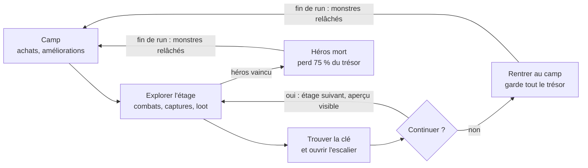

# Dungeon crawler roguelite à capture de monstres — Cahier des charges

Nov 4, 2026 · @Rudy DUBOC — reçu le 07/11, nom du jeu à trouver (dossier provisoire : `donjon-capture`). Idée courte dans [`IDEES.md`](../IDEES.md), section « Idées du 07/11 ».

## Concept

Un dungeon crawler roguelite au tour par tour : le héros descend un donjon procédural étage par étage, capture des monstres pour combattre à ses côtés, et choisit à chaque escalier entre continuer ou rentrer avec son trésor.

- **Genre** : dungeon crawler roguelite, avec une composante de capture de monstres (un peu de collection, sans que ce soit le cœur du jeu).
- **Inspirations** : *Darkest Dungeon* (le choix de continuer ou rentrer), *Pokémon Donjon Mystère* et *Shiren* (le donjon à étages), *Pokémon* (capture, équipe, réserve).

## Boucle de jeu

Une run se termine de deux façons, par la mort du héros ou par un retour volontaire à l'escalier ; dans les deux cas, les monstres sont relâchés et le trésor rapporté finance la run suivante.

## Donjon

Le donjon est généré de façon procédurale et se compose d'étages successifs ; pour descendre, il faut ouvrir l'escalier de l'étage avec sa clé.

- **Clé de l'étage**, trois cas possibles, combinables dans un même donjon : la clé est portée par un monstre, elle est dans un coffre, ou l'escalier est déjà ouvert.
- **Information sur l'étage suivant** : avant de descendre, le joueur voit ce qui l'attend (type d'étage, niveau de danger, étage spécial).
- **Sortie** : uniquement à l'escalier. Le joueur choisit de continuer ou de rebrousser chemin, ce qui le fait sortir du donjon automatiquement.
- **Engagement** : un étage commencé doit être terminé.

## Combat

Les combats se jouent au tour par tour sur un écran séparé, avec le héros et jusqu'à 3 monstres de son équipe sur le champ de bataille.

- **Héros** : c'est un combattant à part entière. En début de run, il est seul.
- **Équipe** : 3 monstres au maximum sur le terrain.
- **Réserve** : le joueur garde sur lui des monstres de rechange, 3 au départ, nombre augmentable par une amélioration permanente, et peut remplacer un membre de l'équipe à tout moment, comme dans *Pokémon*.

  Le monstre qui entre en jeu ne peut ni agir ni utiliser d'objet pendant ce tour.
- **Capture** : se fait pendant le combat (détails dans la section Monstres).

## Monstres

Les monstres sont des alliés temporaires : capturés pendant la run, ils progressent avec l'équipe puis sont relâchés quand la run se termine.

- **Capture** : les ennemis du donjon peuvent être capturés en combat. Plus leurs PV sont bas, plus la capture a de chances de réussir. Elle se fait avec un objet de capture consommable (par exemple un parchemin), et d'autres consommables permettent d'augmenter le taux de capture.
- **Progression** : chaque monstre a son propre système d'expérience et de montée de niveau, du niveau 1 à 15 environ sur une run.
- **Mort** : un monstre à 0 PV meurt, mais reste dans l'équipe ou la réserve avec ses objets équipés, car un objet pourrait le ressusciter.
- **Fin de run** : tous les monstres sont relâchés et leurs objets équipés reviennent dans le sac.
- **Œufs** : une amélioration permanente pourrait permettre de garder des œufs pour commencer une run avec un monstre plutôt qu'avec aucun.
- **Bestiaire** : chaque espèce capturée au moins une fois y est enregistrée définitivement, et c'est ce bestiaire qui débloque les œufs.
- **Espèces** : 12 espèces pour commencer, avec des variantes de couleur pour les versions plus fortes.
- **Évolution** : déclenchée par un objet et non par le niveau, une potion qui fait muter le monstre.

## Héros et loot

Le butin trouvé dans le donjon équipe à la fois le héros et ses monstres.

- **Pour le héros** : objets d'équipement (armes, armures, accessoires).
- **Pour les monstres** : objets dédiés aux monstres de l'équipe.
- **Trésor** : rapporté au camp si le joueur sort du donjon, il sert à acheter entre les runs (section Économie).

## Économie et progression permanente

Le trésor est la seule monnaie : il paie à la fois la préparation de la prochaine run et les améliorations permanentes.

- **Sortie volontaire** : le joueur garde tout le trésor trouvé.
- **Mort du héros** : fin de la run et perte de 75 % du trésor, réduite jusqu'à 50 % au minimum grâce aux améliorations permanentes.
- **Avant une run** : achat de potions et d'objets.
- **Améliorations permanentes** : elles aident à aller plus loin lors des runs suivantes, dont la possibilité de garder des œufs de monstres.

## Difficulté

La difficulté vient uniquement de la montée en niveau des ennemis à mesure qu'on descend.

- Pas de fatigue ni d'autre jauge d'usure.
- La rareté des soins reste la même d'un étage à l'autre.
- À chaque escalier, la décision se résume à : mon équipe est-elle assez forte pour l'étage suivant ?

## Points ouverts

Ces points restent à trancher ; les propositions entre parenthèses ne sont pas encore validées.

- [ ] Liste des améliorations permanentes
- [ ] Nom du jeu
- [ ] Exploration de l'étage : vue de dessus case par case façon Donjon Mystère, ou salles reliées sur une carte (plus rapide au doigt) ?
- [ ] Types des monstres et faiblesses (feu, eau, plante… ou autre chose ?), et nombre d'attaques par monstre
- [ ] Graphismes : tuiles Dungeon Crawl (déjà dans le dépôt, utilisées par La Dernière Lanterne) ou autre pack, à voir en maquette
- [ ] Réutiliser le moteur RPG (`moteur-rpg/`, combat au tour par tour) ou un moteur propre
- [ ] Bestiaire = le « Dex » minimaliste voulu par l'utilisateur (image, type, stade d'évolution, description), consultable depuis le camp (proposition de Claude, 07/11)

## Notes de Claude (07/11)
- Taille estimée ⚫ (plusieurs semaines, comme Donjon de poche ou Nebula) ; Opus pour le moteur.
- Prochaine étape : **maquette d'abord** (2 ou 3 directions sur un écran de téléphone : exploration d'un étage, écran de combat avec héros + 3 monstres, capture, choix à l'escalier), puis validation, puis session 1.
- Le moteur (génération des étages, combat, capture, expérience) se teste sous Node, comme les autres jeux.

## Ressources graphiques : ce que les packs Tiny Swords couvrent (07/11, question de l'utilisateur)
- **Monstres : oui, largement.** L'Enemy Pack a 22 monstres animés (repos, marche, attaque ; certains en plus : garde, coup reçu, mort du troll, sorts du chaman), assez pour 12 espèces et leurs « évolutions » (gobelin → gobelin à lance → cavalier sur cochon, crâne → minotaure…). Les variantes de couleur des versions plus fortes se feraient en repeignant (teinte), le pack n'en ayant qu'une. Voir le [bestiaire](https://claude.ai/artifact/Lgd7UTdT8JTAUq66Uyz1CX).
- **Héros : oui.** Guerrier, lancier, archer, moine (Free Pack, 5 couleurs), épéiste, berserker, roi (Warfare).
- **Donjon : non.** Pas de murs, sols de pierre, portes, escaliers, coffres, clés : Tiny Swords est un pack d'extérieur (herbe, falaises, eau). On pourrait tricher avec les falaises et une herbe sombre (« grotte ») et la grotte de l'Enemy Pack pour l'entrée, mais ce ne serait pas un vrai donjon.
- **Objets : très peu.** 12 icônes d'interface (bois, or, viande, épée, bouclier…) : pas de potions, parchemins, œufs, armes et armures variées.
- **Combat : oui pour l'interface** (rubans, boutons, barres, papier du Free Pack), l'écran de combat séparé se prête bien aux grands sprites de Tiny Swords.
- **Autres ressources que nous avons** : Dungeon Crawl (32 px, CC0, dans le dépôt, avec murs, sols, escaliers, coffres et des milliers d'objets, mais un style très différent de Tiny Swords) ; Kenney All-in-1 (acheté : Tiny Dungeon, Roguelike Dungeon, 1-Bit Pack…) ; le bundle comshadow (Goblin Cave Lair, Sewer Hideout : décors de donjon vus de dessus, style différent, faits « avec l'aide d'une IA »).
- Proposition : la maquette d'abord, avec 2 ou 3 mélanges (Tiny Swords pour les monstres et l'écran de combat + un décor de donjon pris ailleurs ; tout en Dungeon Crawl ; tout en Kenney) ; ou chercher un pack de donjon au style proche de Tiny Swords (64 px, contours épais).
