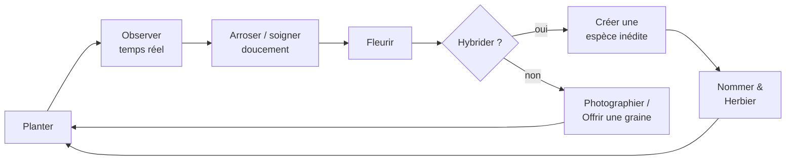

# Racines — cahier des charges (idée du 16/10, à approfondir)

Document de game design fourni par l'utilisateur le 16/10, recopié tel quel (§ 1 à 8). Il a été écrit **avant la création de la Ludothèque** : la section **« Adaptation à la Ludothèque »** (validée par l'utilisateur le 16/10) remplace ce qui ne colle pas au dépôt (Godot, React, OpenWeatherMap, applis iOS/Android). Les points encore ouverts sont dans **« Questions pour le brainstorming »**, à trancher avec l'utilisateur avant de coder.

---

# 🌱 Racines — Document de Game Design

> Un jardin zen flottant dans les nuages. Un jeu **gratuit, sans monétisation**, conçu pour le plaisir de Rudy et de ses proches.

## 1. Vision

**Pitch** : Tu hérites d'une île-jardin qui dérive au-dessus des nuages. Tes plantes poussent en temps réel — même quand le jeu est fermé — et la météo réelle du jour influence ce qui pousse.

**Piliers** :
- 🐌 **Lenteur assumée** — pas de timers stressants, pas de FOMO
- 💛 **Zéro frustration** — aucune plante ne meurt, aucune erreur n'est punie
- 🌍 **Lien avec le réel** — la météo et les saisons réelles nourrissent le jardin
- 👨‍👩‍👧 **Convivial** — pensé pour être partagé avec ses proches, pas pour un marché

**Ce qu'il n'y a pas (et c'est voulu)** : pas de boutique, pas de monnaie, pas de pub, pas d'objectifs chronométrés, pas de classement.

## 2. Univers & narration

Tu reçois une lettre : *« Prends-en soin, et elle prendra soin de toi. »* Avec elle, une île-jardin dérivant au-dessus des nuages, une vieille serre au verre brisé, et une seule graine.

L'histoire avance par fragments : chaque plante rare qui éclot débloque une page du journal de l'ancien propriétaire. Une narration douce, écologique et contemplative, sans urgence.

## 3. Boucle de gameplay

### 3.1 Planter & croiser
- Chaque plante a 2-3 **gènes visibles** (couleur, forme, parfum) et des gènes cachés.
- Croiser deux plantes fleuries peut donner une **espèce inédite** que le joueur nomme et enregistre dans l'**Herbier**.

### 3.2 Temps réel doux
- Une plante commune fleurit en 2-6h, une rare en 6-48h réelles.
- Pas d'accélérateurs : la lenteur EST le jeu.
- Notifications optionnelles : « Ta Fleur-de-Givre a éclos 🌸 ».

### 3.3 Météo du jour
| Météo réelle | Effet dans le jardin |
|---|---|
| Pluie | Arrosage gratuit, plantes aquatiques boostées |
| Canicule | Plantes du désert boostées, arrosage manuel conseillé |
| Neige / gel | Graines de givre apparaissent |
| Temps couvert | Champignons rares |
| Beau temps | Pollinisation facilitée (hybrides plus probables) |

### 3.4 Le jardin qui dort
Une plante négligée pendant une semaine ne meurt pas : elle fait une **sieste**. Un arrosage la réveille, avec un petit effet visuel de bien-être.

## 4. Modes partagés (le cœur du projet)

Comme le jeu est gratuit et destiné aux proches :

- 🎁 **Cadeau de graines** — offre une graine issue d'une de tes plantes à un proche. Elle pousse chez lui avec un message de ta part.
- 🏝️ **Visites** — visite le jardin d'un proche, laisse un mot doux ou un caillou peint.
- 📖 **Herbier familial** — les espèces découvertes par tout le monde enrichissent un herbier collectif.

*Option technique simple : partage par code/lien, sans compte obligatoire. Hors ligne tout fonctionne en solo.*

## 5. Direction artistique & audio

- **Style** : aquarelle, palette pastel évoluant avec les saisons réelles.
- **Parallaxe** : le vent fait onduler fleurs, arches, moulins et lanternes.
- **Musique** : nappes génératives lo-fi qui évoluent selon ce qui fleurit dans le jardin.
- **Sons** : feutrés, doux, jamais alertants.
- **Mode nuit** : luminosité et sons encore plus tamisés, pour jouer au lit.

## 6. Spécifications techniques (ampleur modeste)

- **Cible** : mobile (Android/iOS) + web, éventuellement un petit serveur partagé pour la partie sociale.
- **Tech suggérée** : moteur léger (Godot, ou web React/Canvas), backend minimaliste (Supabase/Firebase ou simple fichier partagé).
- **Sauvegarde** : locale par défaut, synchro cloud optionnelle pour le partage.
- **Météo** : API météo gratuite (OpenWeatherMap) avec repli sur une météo générée si hors ligne.

## 7. Roadmap (phases indicatives)

| Phase | Contenu |
|---|---|
| 🌰 M1 — Prototype | Boucle complète : planter, arroser, fleurir, croiser, herbier |
| 🌿 M2 — Ambiance | DA aquarelle, musique générative, météo réelle |
| 🌸 M3 — Partage | Cadeau de graines, visites, herbier familial |
| 🌳 M4 — Épanouissement | Journal de l'ancien propriétaire, mode nuit, photos |

## 8. Critères de réussite

- « Je peux y jouer 5 minutes par jour sans me sentir nul. »
- « Ma plante a fleuri pendant que je dormais. »
- « J'ai offert une graine à ma mère, elle m'a envoyé une photo de sa fleur. »

Le jeu réussit s'il crée des **moments de partage**, pas des sessions de grind.

*Racines — jeu libre et gratuit, fait avec amour pour les proches.* 🌱

---

## Adaptation à la Ludothèque (validée le 16/10)

- **Technique** : pas de Godot ni de React : un jeu HTML **sans build** dans `racines/`, canvas comme les autres jeux, règles en logique pure dans `racines/regles.js` (croisements, gènes, croissance), testables sous Node. Installé dans l'appli PWA existante, donc Android et ordinateur ; iOS par le navigateur.
- **Temps réel** : la croissance se calcule à l'ouverture à partir de l'heure enregistrée (pas besoin que le jeu tourne). Pas de triche à craindre (pas de classement), mais ignorer une heure qui recule.
- **Météo réelle** : plutôt **Open-Meteo** (gratuit, **sans clé**, donc rien à cacher dans le dépôt) qu'OpenWeatherMap (clé obligatoire). Position : la ville choisie une fois dans les réglages, ou la géolocalisation si on l'accepte. Repli : météo générée à partir de la date et de la saison si hors connexion. À vérifier : que le site d'Open-Meteo est joignable depuis le téléphone (pas depuis l'environnement de Claude, comme Supabase).
- **Notifications** (« ta fleur a éclos ») : difficiles dans une PWA sans serveur d'envoi ; première version sans notification, ou seulement un message à l'ouverture (« pendant ton absence : 2 floraisons »). À étudier plus tard.
- **Partage** (M3) :
  - **Cadeau de graine** sans serveur : un **code de graine** à copier (comme le transfert `LUDO1-` et le code de compte), avec le message de l'expéditeur ; fonctionne tout de suite.
  - **Visites, herbier familial** : demandent un **nouveau script SQL Supabase** (tables jardins, herbier, mots doux) à lancer par l'utilisateur ; réutiliser le numéro de joueur et le pseudo de `ludo-scores.js`. Jamais de clé secrète dans le dépôt.
  - **Photos** : une capture du canvas enregistrée sur le téléphone (bouton PHOTO), à envoyer par les applis habituelles.
- **Pas de classement** (voulu) : le volet de l'accueil montre l'herbier (espèces découvertes) au lieu d'un classement.
- **Direction artistique** : aquarelle pastel, une rupture avec le pixel art ; à juger sur une **maquette de 2 ou 3 variantes** d'abord (règle « maquette d'abord »). Musique générative : reprendre le principe de `nebula/sons.js` (synthèse, sans fichiers), en version douce.
- **Ampleur** : 🔴 gros. Découpage proposé : (1) maquette du style, (2) M1 prototype jouable avec la vraie croissance et les croisements, (3) M2 météo et musique, (4) M3 partage, dont le SQL Supabase, (5) M4 journal, mode nuit, photos.
- **Intégration** : suivre la liste de contrôle de `specs/ludotheque.md` (accueil : `GAMES`, icône, `META`, `NEWS`, volet ; transfert de sauvegarde `LUDO1-` ; `sw.js` ; docs ; artefact). Sauvegarde `localStorage` préfixée `racines.`.

## Questions pour le brainstorming (à trancher par l'utilisateur)

**Public et but**
1. Pour qui d'abord : toute la famille, les adultes, les enfants (lecture, noms des espèces, textes courts) ?
2. Le but à long terme : compléter l'herbier, lire tout le journal de l'ancien propriétaire, agrandir l'île… ou pas de fin du tout ?
3. Combien de temps par jour vise-t-on (5 minutes, comme dans le document) et combien de visites par jour (1, 2, 3) ?

**Jardin et plantes**
4. Combien d'emplacements au départ, et comment le jardin s'agrandit-il (serre réparée, nouvelles parcelles, nouvelles îles reliées par des ponts) ?
5. Combien d'espèces de base au départ, et combien d'espèces au total (herbier) ?
6. Les gènes : lesquels sont visibles (couleur, forme, parfum, taille…) et combien de valeurs chacun ? Les hybrides suivent-ils des règles qu'on peut deviner (comme une vraie génétique simple) ou sont-ils une surprise ?
7. Comment obtient-on de nouvelles graines : récolte sur une plante fleurie, météo (graines de givre), cadeaux, découvertes ?
8. Que fait-on d'une plante fleurie : la garder pour toujours, la récolter, la replanter ? Le jardin finit-il par être plein ?
9. Quels soins au-delà de l'arrosage (engrais, taille, tuteur) ? Garder l'arrosage seul pour rester zen ?
10. Les durées de pousse (2 à 6 h, 6 à 48 h) conviennent-elles, ou plus court pour les enfants ?

**Temps réel et météo**
11. Météo de quelle ville : choisie une fois, ou la position du téléphone ?
12. Les saisons réelles changent-elles le décor et les espèces disponibles (graines de printemps, d'automne) ?
13. Un mode nuit automatique selon l'heure, ou au choix ?
14. Faut-il des notifications plus tard (demande un serveur d'envoi), ou le message à l'ouverture suffit-il ?

**Partage en famille**
15. Ordre des fonctions de partage : d'abord le cadeau de graine par code (sans serveur), puis les visites et l'herbier familial (SQL Supabase) ?
16. Visites : voir le jardin d'un proche en lecture seule, ou pouvoir arroser chez lui ? Le « caillou peint » : un dessin à faire au doigt, ou des cailloux tout prêts à choisir ?
17. Herbier familial : afficher qui a découvert chaque espèce en premier ? (c'est un petit classement déguisé : à garder ou non ?)
18. Utiliser le même pseudo et le même compte que les classements de la Ludothèque (code de compte `LUDOCOMPTE-`) ?

**Style et sons**
19. Aquarelle pastel, d'accord pour une rupture avec le pixel art du reste de la Ludothèque ? Maquette de 2 ou 3 variantes (par exemple aquarelle douce, aquarelle à contours encrés, pastel en aplats).
20. Vue : l'île entière en un écran (téléphone en portrait ?) ou une île qu'on fait défiler ?
21. Musique générative : toujours présente, ou seulement des sons d'ambiance (vent, oiseaux, pluie selon la météo) ?

**Histoire**
22. Le journal de l'ancien propriétaire : combien de pages, qui l'écrit (Claude propose, l'utilisateur relit) ? Une fin à l'histoire (qui était l'ancien propriétaire ?) ?
